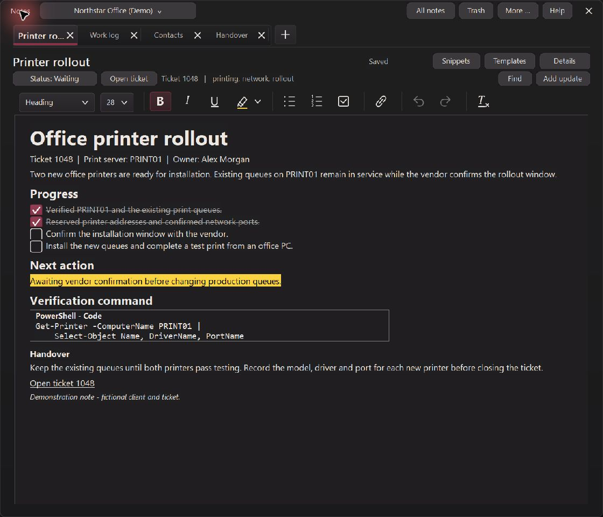
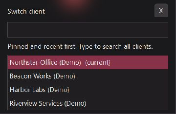
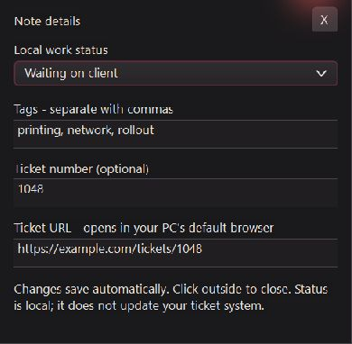
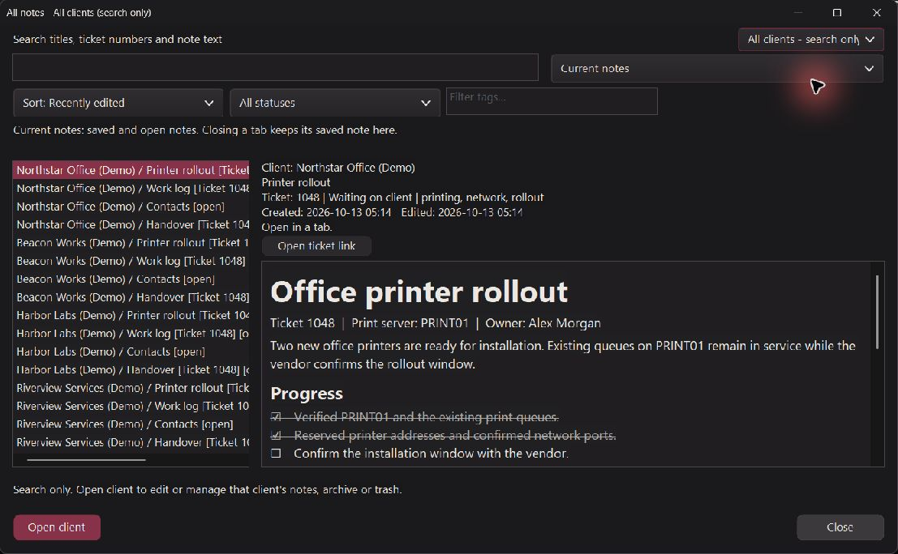
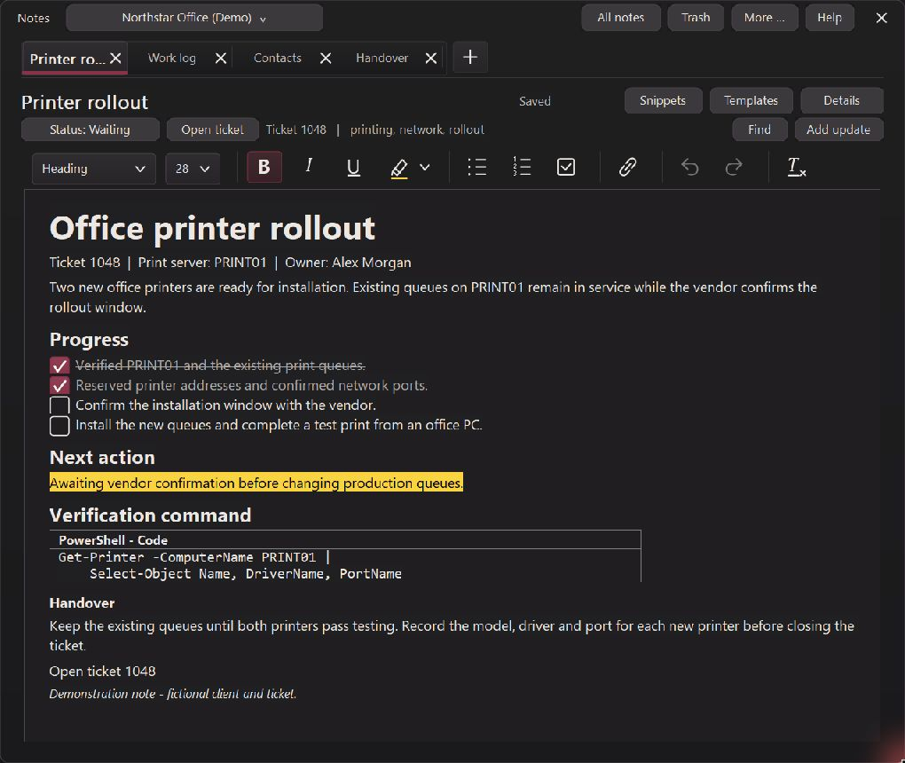

# Inspector on Demand notes — local 6.3.0.0 review

Implemented and reviewed October 13, 2026 in `C:\Projects\ctSpaces`, branch `cpp`.
This continues the selected design trial. The version remains **6.3.0.0**.
No installation, version bump, commit or GitHub publication was performed.
Earlier uncommitted notes features and packages were preserved.

## Native design and navigation

- **Notes** sits immediately left of **Close all** in the main launcher. It opens
  the selected client, or the last notes client when none is selected.
- Notes has one client picker, slim tabs, a compact document heading and full-width
  editor. There is no permanent sidebar or duplicate main-app header.
- The picker searches active clients by typing. It shows at most eight matches,
  with pinned and recent clients first, and supports keyboard navigation.
- **Switch client**, **Details / Status**, and **More …** are modeless temporary
  panels. Clicking outside or pressing Escape dismisses them while leaving the
  editor's dimensions unchanged. The More label uses a plain ellipsis.
- **Details** combines ticket number, ticket URL, local status and tags. Valid
  changes autosave and flush on dismissal. Invalid values retain a recoverable
  in-memory draft without replacing saved metadata; closing the notebook warns
  before discarding that invalid draft. Ticket numbers retain their 128-character
  allowance. Ticket URLs and document links retain the PC default-browser route.
- Snippets, Templates, Find and Add update remain directly accessible. More is
  searchable and explains its selected action. The walkthrough reflects the new
  launcher, client picker, Details and More navigation.
- Theme support, remembered dimensions, autosave without footer buttons, compact
  paragraph spacing and existing templates/snippets/code/work-log behavior remain.

## Management and client isolation

All notes and Trash remain substantial, separate management windows with normal
close controls. They retain search, previews, sorting, status/tag filters, multiple
selection, recovery and permanent deletion controls. Each remembers its size.
Trash has no automatic expiry; Empty trash affects the current client's deleted
notes after a confirmation naming that client and the number affected.

**This client** is the default scope. **All clients — search only** creates an
independent read-only preview, explicitly showing client ownership. Open client
navigates into that client's own notebook before editing or management. Mutations
are blocked even through direct command messages in the combined scope. Local
note IDs are resolved with their owning client, including colliding IDs.

Switching clients flushes pending edits to the original notebook first; a failed
save prevents switching and preserves the draft. Stale picker selections cannot
reopen deleted clients, and stale Details panels cannot change a different note.
The production client-deletion path was tested on disposable clients: deleting
client A left client B's notebook bytes unchanged.

## Validation and visual review

The native production-dialog suite passes **471 checks**. Coverage includes
outside-click and Escape dismissal, full panel field borders, unchanged editor
dimensions, retained invalid metadata, searchable client selection with 100
clients, ownership and save-before-switch, cross-client read-only commands,
duplicate local note IDs, production client deletion and manager dimensions.

Live review used disposable demo clients and the native Windows app through the
computer-use skill. It checked the main Notes button, full-width editor, compact
client picker, Details, More, All notes and the themed All clients dropdown.
The new scope was initially missing from the shared combo drawing handler,
producing a blank white dropdown; the final handler and rendering regression
check correct this.

Live drag review also exposed cached paragraph wrapping after small changes in
window width. RichEdit can report an updated rectangle before recalculating its
lines. Layout now compares actual editor width across positioning and refreshes
its wrapping when that width changes. A 1120-to-1020-pixel native drag reflowed
the demo prose and handover text. Automated visible-editor checks cover both a
large resize and repeated ten-pixel resize steps. Existing assertions still
verify no synchronous whole-window repaint, document streaming or saving during
resize, and retained document content and formatting.

The suite was repeated only for changes and observed failures. Clipboard fixtures
intermittently exposed Paste but inserted no text, or failed their Ctrl+V check;
the same executable was rerun separately. Their root cause has not been established.
The final separate run passed all 471 checks, including both clipboard routes.
The prior chat's request-preparation failure also remains unresolved; this work
does not diagnose or claim to fix it.

Release build, release gates, guided-walkthrough source checks and Microsoft
Defender scan passed. The final resource rebuild embeds the new native workspace
capture; it does not change application behavior. Packaging verifies one root
`ctSpaces.exe` and matching executable bytes. Installer/startup scenarios and
other browser engines were not requalified for this design trial.

Evidence:

- `build/notes-inspector-build.log`
- `build/notes-inspector-tests.log`
- `build/notes-inspector-release.log`
- `build/notes-inspector-guide.log`
- `build/notes-inspector-defender.log`
- `build/notes-inspector-package.log`
- `build/notes-inspector-result.json` (final paths and SHA256 hashes)

Local review package: `build/notes-inspector-review/ctSpaces6.3.0.0.zip`.

## Native captures

