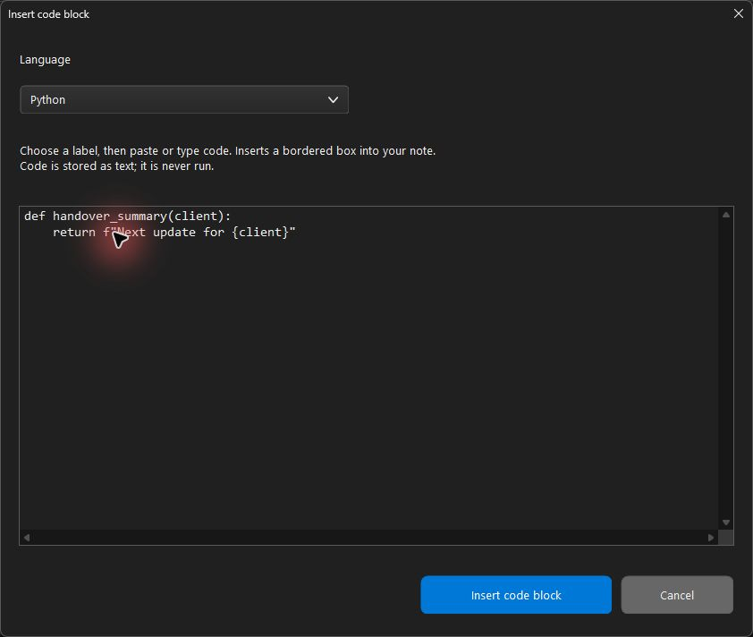
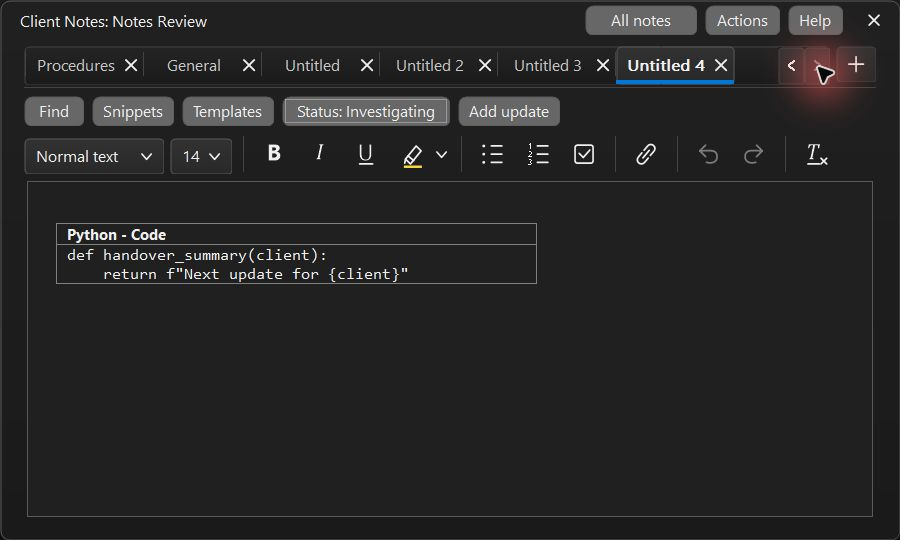
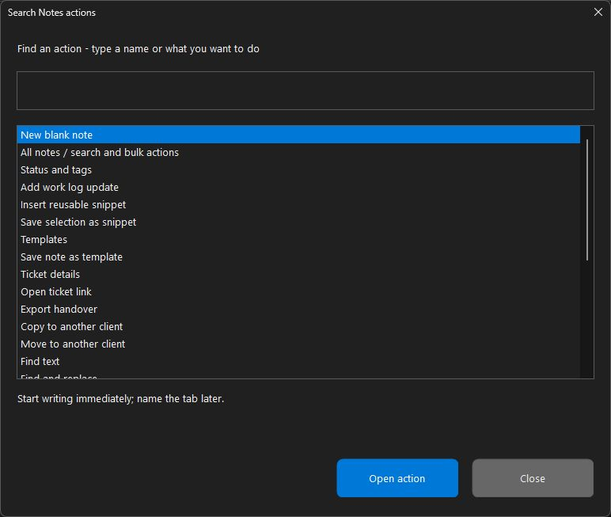
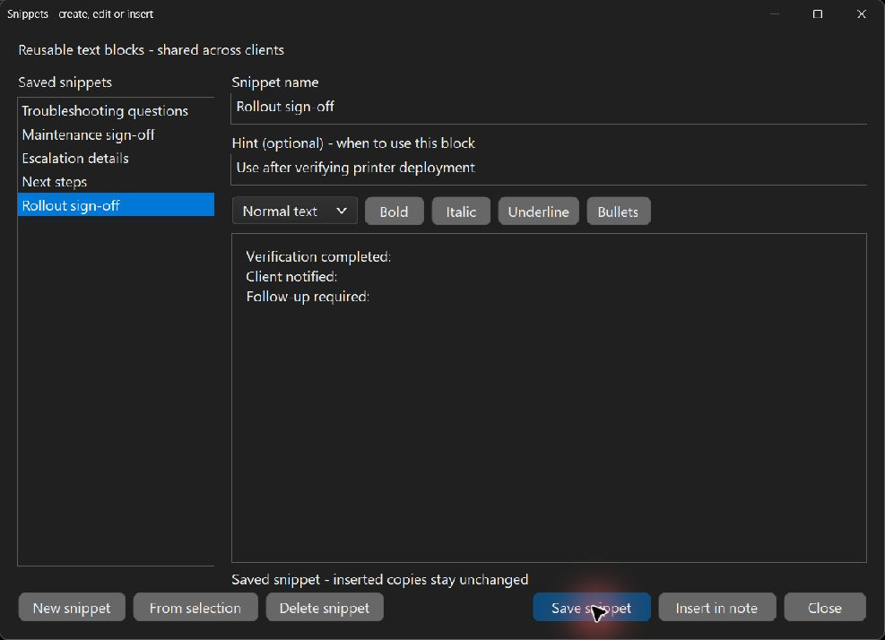
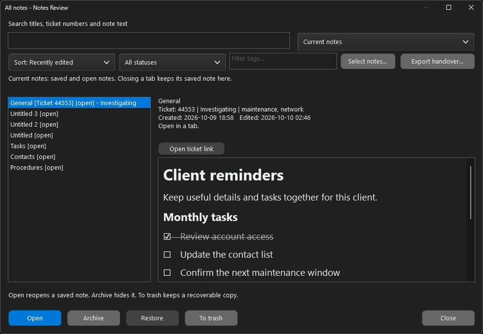

# Notes productivity guide

Applies to ctSpaces 6.3.5.0. The [User Guide](USER_GUIDE.md) describes the complete
Notes workspace; [release validation](RELEASE_VALIDATION_6.3.5.0.md) records test scope.

The editor keeps its slim tabs, theme colors, quiet autosave and remembered
window bounds. One compact row contains Find, Snippets, Templates, Add update,
Format and Details. Selecting text or clicking Format opens the formatting
palette on demand. The small status icon and label beside Details are read-only;
No status hides them. There is no permanent formatting toolbar or footer.
Normal saving shows no Saved/Saving label; only save/load or invalid-details
problems stay visible. Switching clients keeps the same Notes window in place.

| Feature | Where to find it | What it does |
| --- | --- | --- |
| Quick capture | Select a client, Settings > Quick note; or right-click a pinned client > Quick note | Opens a small plain-text capture window with an optional title. Autosaves a closed note into that client's notebook. |
| Searchable actions | More, or Ctrl+K in the editor | Search command names and descriptions, read the selected hint, then press Enter or Open action. |
| Reusable snippets | Snippets | Create, edit and save shared text blocks, then insert one at the cursor in the current note. |
| Simple note status | Details, or More > Status and tags | Choose No status, Investigating, Waiting on client, Follow-up needed, or Resolved. The read-only icon and label beside Details show the current status; use Details to change it. |
| Tags | Details, or More > Status and tags | Add comma-separated tags, up to 16 tags of 32 characters each. |
| Sorting | All notes > Sort | Recently edited, newest created, title, or ticket number. Sorting changes the results view, not the notebook's tab order. |
| Ongoing work log | Add update, or More > Add work log update | Append a dated update section to the current note and continue writing. Earlier updates remain. |
| Bulk actions | All notes > Select notes | Tick several notes, select all visible results, clear selection, or finish selecting. Archive, Restore, To trash, and Delete forever apply to ticked notes. |
| Readable handover | More > Export handover, or All notes > Export handover | Write one standalone HTML document with the selected notes, client, titles, status, tags, dates, ticket links, and readable text. |

**Templates** combines creation, editing and use in one window. Select a saved
starter or click **New template**, edit its name, hint and formatted content, then
click **Save template**. **Use template** saves pending changes and creates an
independent client note. **From current note** optionally seeds a new template
draft from the current note. You can author a template without opening a note.
Switching templates or closing protects unsaved edits with Save, Discard and
Cancel. Templates use an explicit Save button; client notes still autosave.
Ctrl+S saves the template while editing its content. Ctrl+V and Shift+Insert
paste plain text, matching client notes.
Status describes your local work on the note or ticket; it does not synchronize
with the ticketing system.

## Ticket sign-in and note capacity

**All note links**, including **Open ticket link**, saved ticket URLs, pasted
URLs, and labeled links, use your chosen regular PC browser session. Choose
**Details > Open links in**, below the ticket URL, or **More > Link browser**.
System default follows Windows; alternatively choose an installed Microsoft Edge,
Google Chrome, Brave or Firefox for work links while leaving your personal
Windows default unchanged. This preference applies to every client notebook.
Links never use a client's isolated browser profile. The confirmation names the
destination browser; an unavailable chosen browser is reported without silently
opening another browser.

The former 256-note cap was an implementation guard, not a storage-format
requirement. It is now **10,000 notes per client**, including closed, archived,
and deleted notes. The notebook remains limited to **256 MiB** in total,
including revision history. Either bound can be reached first. Shared template
and snippet libraries retain a separate 256-entry limit. Older builds with the
256-note cap safely reject larger notebooks; export before downgrading.

## Keep code separate from prose

Open **Format** and choose **Code** in the text-style dropdown, or use **More > Insert code block**.
A dialog appears with a language dropdown and a source editor. Choose a label
such as PowerShell, Python, SQL, JSON, C#, or Log output, then paste or type code
and click **Insert code block**. Selected prose pre-fills the source editor and
is replaced by the block after insertion. Cancel leaves the note unchanged.

The result is an editable bordered box with a language caption and monospaced
source. The box uses theme-aware text and background, a neutral border, and a
fixed width that fits the minimum notes window. Long lines wrap within it.
Continue normal writing after the box; edit source directly inside it. To change
the caption, edit its text. Nested boxes are blocked. Inserting a block is one
Undo action, and notebook/history/RTF exports retain the box and caption.

The language is a label, not a compiler or syntax-highlighting engine. Code is
never executed. Each block supports up to 131,072 characters. Readable handover
export includes its caption and text, with simplified formatting.

## Capture without opening the full editor

Write the body first. A title is optional; the default is **Quick note**, with a
number added if that title already exists. Autosave runs after a short pause and
closing flushes any pending text. Continuing to type updates the same note.
An untouched, empty capture creates no note. Open the saved capture from
**All notes** when you need headings, highlights, checklists, or other formatting.

A failed save keeps the draft window open and explains that the text was not
saved. Copy the text or retry closing; a competing notebook change is never
silently overwritten. Capturing for a client whose full Notes window is open
first saves and closes that editor to avoid competing writes.

## Find commands without memorizing a menu

Click **More** or press **Ctrl+K** in the Notes workspace. Type words such as
`tags`, `snippet`, `work log`, or `export`. The list searches command names and
hints. Commands requiring a note are hidden when no note is open. An empty
result disables Open action.

**All formatting and window commands** opens the complete menu for additional
styles, link operations, zoom, always-on-top, and checklist progress.

## Reuse blocks of text

**Templates** create a separate starter note. **Snippets** insert a block into
the note you are editing. They have separate shared libraries.

1. Put the cursor where the block belongs.
2. Click **Snippets** and choose a saved block. Its name, hint and formatted content are editable.
3. Click **Insert in note**. It saves the latest changes first. If text was selected,
   the block replaces that selection; otherwise it inserts at the cursor.
4. To create your own snippet, choose **New snippet**, give it a unique name and optional
   hint, write directly in its editor, then **Save snippet**. This works without an open note.
5. **From selection** starts a new editable draft from selected text in your current
   note, or the whole note when nothing is selected. **More > Save selection as snippet**
   opens the same editor with this draft already prepared.
6. Deleting or updating a snippet leaves previously inserted text unchanged.

Rich-text selection is retained. Note status, tags, ticket metadata, history,
and window state do not become part of a snippet. The starter blocks cover
troubleshooting questions, maintenance sign-off, escalation details, and next steps.

## Organize work in All notes

Work status is separate from whether a tab is open, archived, or in trash.
For example, **Resolved** does not automatically archive a note.

The main search includes title, ticket number, content, status, and tags.
The lifecycle, status, and tag filters combine. Tag filtering matches part of
a tag, without case sensitivity. **Recently edited** puts recorded recent edits
first; old notes with no recorded dates remain available. Ticket sorting uses
natural numeric ordering.

Choose **Select notes > Select several notes** to enter selection mode. Click a
result or press Space to toggle its tick. **Select all visible notes** selects
the filtered results, including rows beyond the screen. The hint shows the count.
Changing search, status, tags, sorting, or lifecycle clears the ticks so hidden
notes are not acted on accidentally. **Finish selecting** returns to normal
preview and Open. With selection mode active, zero ticks means no action.

Bulk **Archive**, **Restore**, and **To trash** keep recoverable notes. In
**Trash**, **Delete forever** confirms the selected count before
permanently removing those notes and their histories. **Empty trash** has a
different scope: every deleted note for this client, including results hidden
by filters. Its confirmation names the client and full count. There is no
automatic trash expiry, and deleted notes count toward the 10,000-note limit.

## Keep a log and hand over work

**Add work log update** appends a date and time heading at the end of the current
note. Record what changed, outstanding work, the next owner, and the next update
under it. This is a manual log inside the note, not automatic activity tracking.

**Export handover** in the editor exports the current note. In All notes it
exports the ticked notes, or the previewed note when selection mode is off.
The HTML file opens in a browser and can be printed or saved as PDF there.
Rich formatting is simplified to readable text, with preserved line breaks and
checklist characters. Revision histories are excluded. No export sends anything.
The HTML export supports up to 32 MiB of UTF-8 content; an oversized export
reports failure and leaves the notebook intact.
For a restorable notebook with history and metadata, use **Export client notebook**.

## Compatibility and storage

Current ctSpaces reads notebook formats 1–5 and legacy TXT/RTF notes. Saving uses
the format required by the data: format 2 for the base notebook, 3 for status and
tags, 4 for revision link targets, or 5 for exact labeled-link occurrences in
notes or history. A notebook without status or tags can still need a newer
format because of its links. Each labeled-link occurrence keeps its own target;
the same visible caption does not force links to share one address.

Older builds refuse notebook formats they do not understand instead of
overwriting them. Keep a full notebook export or backup before downgrading, and
export individual notes as TXT/RTF for use in older applications; these document
exports do not retain all notebook metadata or history. Shared snippets are
stored separately in `NotesSnippets` under the app's data folder; templates
remain in `NotesTemplates`.

Replay **Help > Step-by-step walkthrough** for the 14-topic in-app guide.
