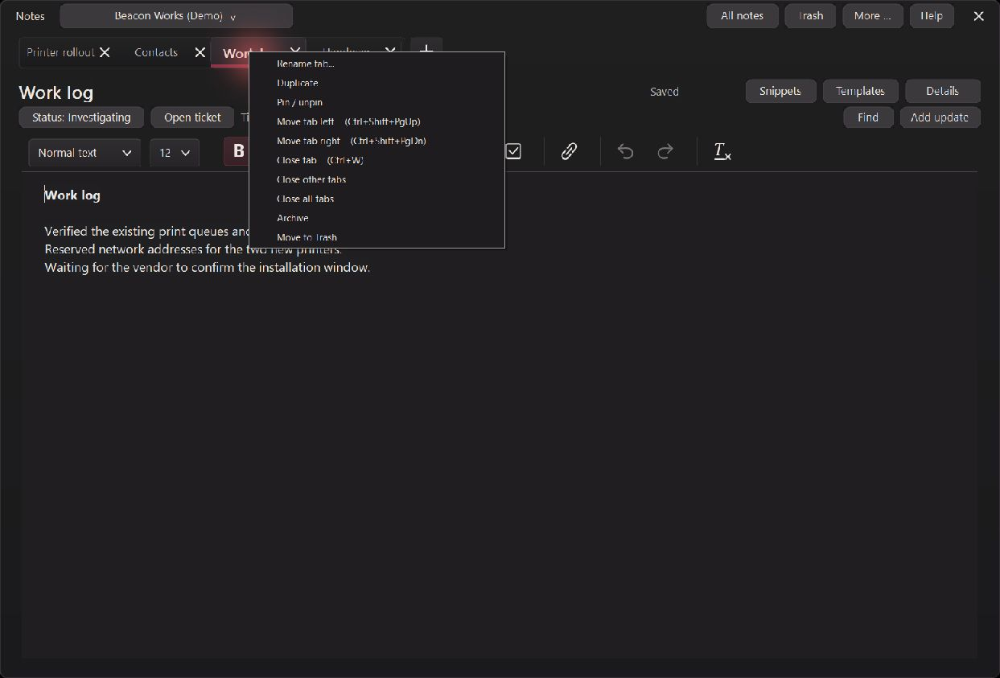
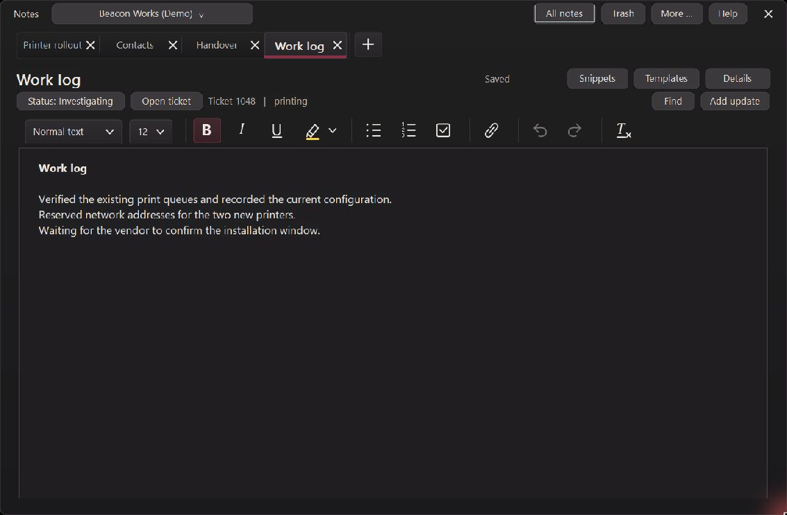
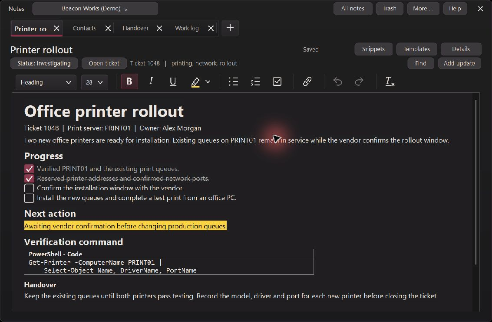

# Notes tab order and branch review — 6.3.0.0

Reviewed October 13, 2026 in `C:\Projects\ctSpaces`, branch `cpp`. This change
continues the Inspector on Demand design and includes the previously uncommitted
notes work. Version **6.3.0.0** is unchanged. The user authorized committing and
pushing the review branch; this is not a new GitHub release or installation.

## Tab behavior

- Drag tabs within their pinned or ordinary group. The native control selects
  the source on mouse-down, then the subclass owns mouse capture for the gesture.
  Native mouse-move handling no longer interferes with that capture.
- An accent insertion line shows the destination. Drop outside the row, Escape,
  cancellation or lost capture clears the gesture without moving the tab.
- The tab context menu and searchable actions offer **Move tab left/right**.
  **Ctrl+Shift+PgUp / Ctrl+Shift+PgDn** moves the active tab. Menu commands are
  disabled at group boundaries. Hover hints explain dragging and right-click.
- Reopening a closed note through All notes, cross-client search or
  Ctrl+Shift+T appends it to its group. Selecting an open note keeps its position.
- Pages and their formatting baselines move together. Stable IDs retain the
  active document, cached editor, caret and independent undo history. Notebook
  saves persist order without a schema change. Save-before-switch prevents a
  failed save from losing the current draft.

The selected design remains: one searchable client picker, full-width notes,
slim themed tabs, panels on demand, autosave without a footer, and remembered
window dimensions. All notes and Trash remain separate management windows.
Notebooks remain owned by their clients. Earlier template, snippet, status,
tag, work-log, bulk-action, code-block and default-browser link work is retained.

## Attempts to break it

The native production-dialog suite passes **506 checks**, including **320
deterministic reorder/close/reopen cycles across 64 notes**, eight pinned tabs
and native tab overflow. Every cycle compares expected order, active document
content, metadata and formatting baselines. A subsequent application restart
checks saved order. Concurrent writer fixtures verify refused moves/reopening,
preserved active drafts and recovery files, and protected newer notebook bytes.

New visible native-control checks cover capture after source selection, capture
during mouse movement, the actual painted insertion marker, ordinary clicks,
cancel and outside drops, context-menu boundaries, explicit move commands,
All notes opening, pinned reopening and restart persistence. Existing checks
also cover client isolation/deletion, outside-click panels, invalid metadata,
clipboard routes, snippets/templates, resize and wrapping, trash, recovery,
formatted content, undo and link-launch boundaries.

The first stress run applied its metadata assertion to the fixture's pre-existing
note as well as the 64 stress notes. That assertion was corrected to use the
stress note IDs. It was a test-fixture issue, not observed note corruption.
The next complete run passed. No clipboard retry was needed in these runs;
the intermittent clipboard failures documented in the previous review remain
unexplained. The earlier chat's request-preparation failure also remains unresolved.

Live Windows review used the computer-use skill and the existing disposable demo
clients with the newly built executable. Actual mouse/keyboard input verified:
dragging Work log after Handover, Ctrl+Shift+PgUp, the context-menu move command,
closing a middle tab, reopening from All notes at the end, native corner resize,
and closing/reopening the notebook with the same order and dimensions. User
client data and the installed executable were not changed.

**Unresolved visual defect found in live review:** after corner resizing,
switching cached tabs and scrolling the formatted demo note, parts of the native
code box's outline were missing. Reopening the notebook did not clear it. The
saved RTF still includes top, bottom, left and right cell-border definitions;
the code and language caption remain intact. The rendering cause has not been
established, and this review does not claim to fix it. This is a release review
item: the branch is pushed for evaluation, while a new GitHub release remains
unpublished. The 506 checks do not assert every native table-border pixel.

Release x64 compilation passed without warnings or errors. The native test
harness emits existing compiler warnings. Storage tests passed, including
10,000-note round trips, Unicode/status/tags, malformed/truncated snapshots,
atomic-write failures and unsafe paths. Release gates and guided-walkthrough
source checks passed. Microsoft Defender reported no threats on the final EXE.
Packaging verifies exactly one root `ctSpaces.exe` with matching bytes.
Installer deployment, additional browser engines and a second physical DPI
environment were not requalified for this branch review.

## Evidence and package

- `build/notes-tab-order-build.log`
- `build/notes-tab-order-tests.log`
- `build/notes-tab-order-storage.log`
- `build/notes-tab-order-release.log`
- `build/notes-tab-order-guide.log`
- `build/notes-tab-order-defender.log`
- `build/notes-tab-order-package.log`
- `build/notes-tab-order-result.json` (hashes and push outcome)

Review package: `build/notes-tab-order-review/ctSpaces6.3.0.0.zip`.
Earlier packages are preserved, including the Inspector review package.

EXE SHA256: `4F39BE46F51FDF2719751A7C390453F1CEE6A949F283F769BED7F0876DA98945`

ZIP SHA256: `EBFFB46E051465942E883F27B3EFB4ECD895E7728F6C8D82D11DAB8FDF9A86F8`

## Follow-up, October 13

The code-border defect illustrated above is resolved in 6.3.1.0. Scroll, repeated
resize and cached-editor pixel regressions pass. See
[FULL_APP_STRESS_REVIEW_6.3.1.0.md](FULL_APP_STRESS_REVIEW_6.3.1.0.md) for the broader
application review and additional real-input corrections.
