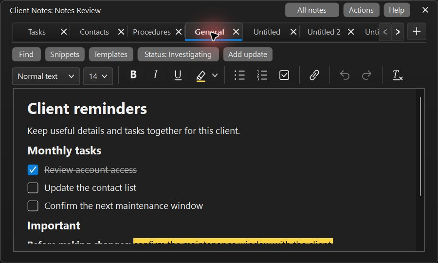
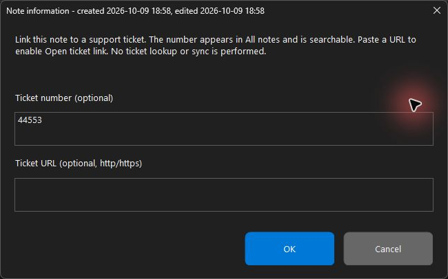
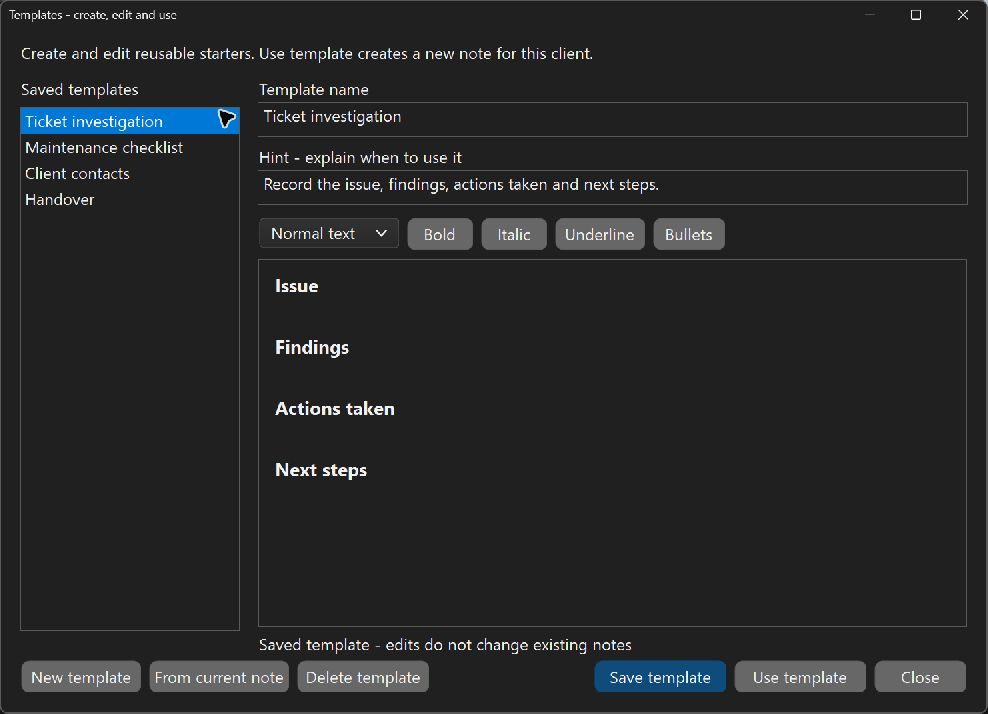
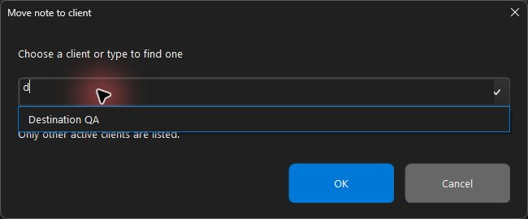
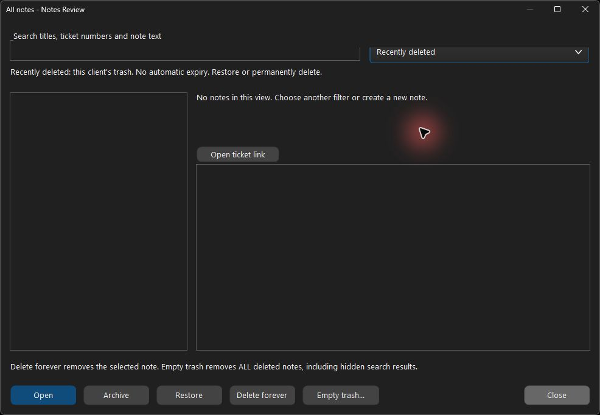

# Using Client Notes, step by step

Applies to ctSpaces 6.3.5.0. See the [User Guide](USER_GUIDE.md) for current
controls and [release validation](RELEASE_VALIDATION_6.3.5.0.md) for test scope.

The in-app guide has fourteen topics, including quick capture, searchable More actions,
status/tags and sorting, snippets/work logs, and selecting/exporting several notes.
See the [Notes productivity guide](NOTES_PRODUCTIVITY.md) for the complete new flows.

Click **Notes** beside **Close all**. Select an existing client or return to the
remembered notebook; no client browser needs to be open. **Settings > Client
Notes** and the client's context menu offer another route.
You can replay these steps inside the notes window through **Help > Step-by-step
walkthrough** or **More > Notes walkthrough**. Use **Next**, **Back**, or the topic
selector. Reading the walkthrough does not change your notes.

The screenshots show a disposable example client in a dark theme. Your notes
use your selected app theme. Notes save locally with their client.

## 1. Start a note and let it save

1. Click **+**, or press **Ctrl+T**. An **Untitled** tab opens immediately.
2. Start typing. You can name the note later; no title is required before writing.
3. Pause briefly to let autosave run. Switching tabs or closing the notes window
   also saves pending edits. There is no Save button, Saved/Saving label or permanent
   footer. A save, load or invalid-details problem is shown until resolved.
4. Resize the window to suit your screen. Its size and maximized state are remembered.
   Switching clients reuses this same window and keeps its position and size.

## 2. Format text, highlights and checklists

1. Select words to show the formatting palette, or click **Format** to open it at
   the typing position. Choose a heading, font size, **Bold**, **Italic**, or **Underline**.
2. Click the highlighter's arrow to select a color. Use the marker button to apply
   or remove the chosen highlight.
3. Choose the checklist button to create tasks. Click a task's box to mark it done;
   its text is struck through. **Enter** adds an unchecked item. **Enter** on an
   empty item ends the list. **Tab / Shift+Tab** change list indentation.
4. Select text and choose **Link** to add a label and web address. Detected HTTP/HTTPS
   URLs also work. All note links ask before opening in your chosen regular PC
   browser, outside client profiles. **Details > Open links in** or **More > Link
   browser** selects System default or an installed Edge, Chrome, Brave or Firefox
   once for every client notebook. An unavailable chosen browser is reported
   rather than silently replaced with another browser.
5. Use Undo/Redo for editing mistakes. Right-click for Cut, Copy, Paste, and Select
   all. Pasting inserts plain text.

## 3. Name, organize and close tabs

1. Double-click a tab to rename it. Hover over a shortened name to read the full title.
2. Right-click a tab for rename, duplicate, pin, close, archive and deletion actions.
   Drag tabs to reorder them within their pinned or unpinned group; an accent
   line marks the drop position. The menu also offers **Move tab left/right**,
   available with **Ctrl+Shift+PgUp / Ctrl+Shift+PgDn**.
3. Use **Ctrl+Tab / Ctrl+Shift+Tab**, scrolling over tabs, or the overflow arrows to
   reach other open notes.
4. Click a tab's **X**, or press **Ctrl+W**, to close it. A saved note stays in
   **All notes**. **Ctrl+Shift+T** reopens the last closed tab in this session.
   Reopened notes go to the end of their group; selecting an already-open note
   keeps its current position.

Closing a tab does not delete the saved note or move it to trash. A newly created,
unnamed note that was never edited is discarded when closed. Closing every tab
leaves an empty workspace with **+** and **All notes** available.

## 4. Find and reopen a saved note

1. Click **All notes**. The current note is selected when it is in the results.
2. Search for part of a title, a ticket number, or some note text.
3. Select a result to preview it. Ticket numbers appear beside titles and above the preview.
4. Choose the appropriate filter:

| Filter | What it shows |
| --- | --- |
| Current notes | Saved and open notes, excluding archived and deleted notes |
| Open tabs | Only notes open in the notes window |
| Archived | Notes kept out of Current notes |
| Trash | This client's recoverable trash |
| Current + archived | All kept notes, including archived ones |

5. Select a current note and click **Open**. Restore an archived or deleted note
   before opening it. The labels `[saved]`, `[open]`, `[archived]` and `[deleted]`
   show each result's state; `[saved]` means its tab is closed.

## 5. Link a note to a ticket, if useful

1. Open the note, then choose **Details**.
2. Enter a ticket number, such as `T20260921.0622`. Changes save automatically; click
   outside the panel to close it. The number labels the
   note in All notes and can be searched.
3. Enter an HTTP/HTTPS ticket URL to enable **Open ticket link** in All notes and
   More. **Details > Open links in**, below the ticket URL, chooses the regular PC browser for note and ticket
   links, keeping the ticketing session separate from client browser profiles.
4. Use **Details** to set the note's work status and tags. A small status icon and
   label beside Details reflect the selected status. **No status** hides the
   indicator. These are local labels, with no ticket-system sync.

These fields contain a label and address you supply. They do not fetch ticket
messages, import ticket data, or synchronize with a ticket system. Both are optional.

## 6. Use or customize a template

1. Click the top **Templates** button, or choose **More > Templates**.
   Select a saved starter to read or edit its name, hint and formatted content.
2. Click **New template** to write your own starter directly in this window.
   Enter a name and hint, then write its content. Use the formatting row for
   headings, bold, italic, underline and bullets.
3. Click **Save template** to keep the starter. **Use template** saves pending
   changes, then creates an independent client note from the starter.
4. **From current note** optionally copies the current client note into a new
   template draft. You do not need a client note open to author a new template.
5. When switching templates or closing, choose Yes to save, No to discard, or
   Cancel to keep editing if there are unsaved changes.

Templates are shared across clients. Updating or deleting a template does not
change notes already created from it. Templates use an explicit Save button;
client notes still autosave. A single client notebook export does not include
the shared template library.

## 7. Copy or move a note to another client

1. Open the note. Choose **More > Copy to another client** or **Move to another client**.
2. Choose another active client from the dropdown, or type part of its name to
   filter suggestions. Select the destination and click **OK**.
3. Check the client named in the confirmation before proceeding.
4. Open Client Notes for that destination client to find the transferred note.

Copy keeps the original. Move saves the destination copy first, then keeps the
source in the original client's Trash view. It does not merge notebooks.

## 8. Archive, use trash, and restore a note

The **Trash** button beside **All notes** opens deleted notes directly. Trash is
also available from Help and searchable More actions. It replaces the old
"Recently deleted" label; retention and restore behavior are unchanged.

1. In All notes, select a current note. **Archive** keeps it but hides it from
   Current notes. **To trash** moves it to Trash.
2. Choose **Archived** or **Trash** to find it again.
3. Select it and click **Restore**. It returns as a saved note with its tab closed.
4. Switch to Current notes, then select it and click **Open**.

Trash is this client's trash bin. Notes do **not** expire automatically.
Deleted notes still count toward the 10,000-note limit. Closing a tab, archiving and
moving to trash are different actions.

## 9. Permanently delete a note or empty trash

> **Empty trash permanently deletes all deleted notes for this client and their
> revision histories. This cannot be undone in the app. It also includes deleted
> notes hidden by a search. Export a client notebook or make a full backup first
> if you might need them later.**

1. Open All notes and choose **Trash**. Review the contents.
2. **Delete forever** removes the selected deleted note and its history.
   **Empty trash…** removes every deleted note for this client in one operation.
3. Read the client name and total count in the confirmation. **No** is the default.
   Choose **Yes** only when you intend permanent removal.

Empty trash keeps current notes, archived notes and other clients' notebooks.
A failed save blocks the operation before erasing notes. It is disabled when the
trash is empty, and it works even when your current search has no matching results.

## 10. Recover, export and keep working

1. Use **Ctrl+F** to find text in the open note, or **Ctrl+H** to replace it.
   The temporary search rows include Match case, Whole word, Wrap and a match
   count. Replace all is one Undo action; Escape returns the rows' space to the
   document. Search **More** for Word wrap, Go to line (**Ctrl+G**), Document
   information, Check spelling (**F7**), Print/PDF (**Ctrl+P**), Markdown
   import/export or Insert table. These tools appear on demand.
2. **More > Version history** previews earlier text and formatting before restoring
   them. It is a bounded recovery history, not a complete record of every keystroke.
3. If the title reports a failed save, keep the window open. Use **More > Retry
   saving**, **Copy entire note**, or **Export this note** to preserve your draft.
   **Resolve save conflict** handles a notebook changed elsewhere.
4. **Export this note** writes TXT or RTF. **Export client notebook** writes a `.ctn`
   copy including ticket metadata, labeled links, archived/deleted notes and history.
   TXT/RTF exports contain the document; they do not include the separate metadata.
5. **Import** previews supported text/RTF or notebook contents before adding notes.
   After an abandoned editing session, ctSpaces can offer recovery as separate copies.
6. Click **Finish** in the walkthrough to return to your notes. Replay it whenever
   needed through Help or More.

For limits, browser behavior and backup details, see the [User Guide](USER_GUIDE.md).
